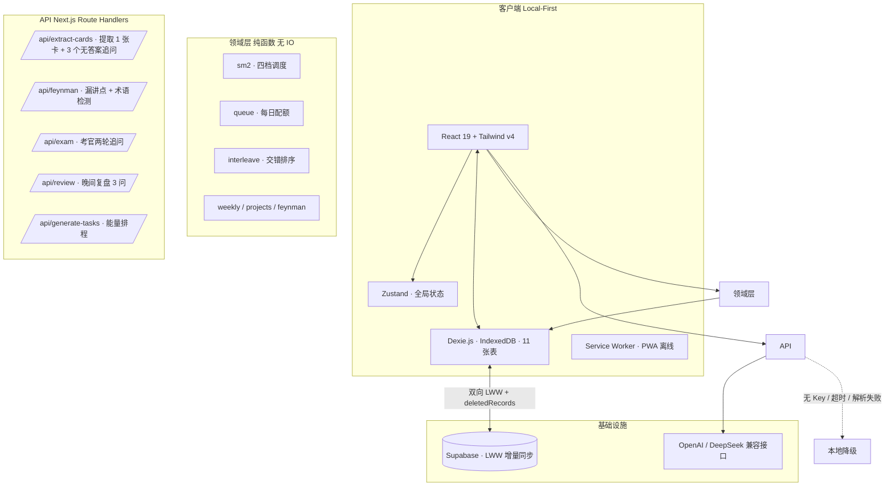

# 🟢 GrowthOS

**把六种学习方法做成一个每天能跑完的闭环。**

不是又一个待办清单，也不是又一个 AI 聊天框。这是一个「学习操作系统」：从今天该做什么、到复习哪张卡、到怎么把学到的东西讲出来、到一周做一个小项目，全部落在同一条链路上——而且每天的入口只有一个最小动作。

> 设计原则只有一条：**如果一个功能不能回答「今天该干什么」，它就不该出现在首屏。**

---

## 一、六个方法 ↔ 六个页面

这份代码的骨架就是一张表。每个页面负责一种方法，多一个都不加：

| 方法 | 页面 | 落在哪里 |
|---|---|---|
| **间隔重复** | 复习 | 四档 SM-2（忘记 / 困难 / 良好 / 简单），评分按钮上直接印出「下次是几天后」 |
| **主动回忆** | 复习 | 「先说后看」：翻面前先说一遍答案，语音输入 + LCS 比对给出覆盖率 |
| **交错练习** | 复习 | 不同题型 / 主题混排，不连着刷同一种（`src/lib/learning/interleave.ts`） |
| **费曼输出** | 输出 | 三步强制：讲一遍 → 标出卡壳点 → 100 字大白话。讲不通的地方就是要回去补的地方 |
| **每周复盘** | 看板 | 周日 15 分钟，只问三件事：哪一步真做到了 / 哪一步是伪努力 / 下周只改哪一个变量 |
| **项目实践** | 看板 | 一周一个可展示的小项目，7 天是硬约束；「难题—解法」记录就是面试故事的原料 |

另有两个支撑页面：**今日**（今天的最小动作 + 能量 + 专注）和**制卡**（把输入变成能问住自己的问题）。

---

## 二、架构



**分层纪律**：`src/lib/learning/` 全是纯函数，不 import Dexie、不读时钟（时间一律从参数传入）。所以调度、队列、交错、复盘这些逻辑都能用 `node --test` 直接跑，不需要浏览器。

---

## 三、快速开始

```bash
pnpm install
cp .env.local.example .env.local   # 没有这个文件就手动建
pnpm dev
```

### 环境变量

AI 与云同步都是**可选**的：不配也能完整跑（本地降级 + IndexedDB）。

```env
# ---- 大模型：配任意一组即可。DeepSeek 优先 ----
DEEPSEEK_API_KEY="sk-..."
DEEPSEEK_API_BASE_URL="https://api.deepseek.com/v1"   # 可选
DEEPSEEK_MODEL="deepseek-chat"                        # 可选

OPENAI_API_KEY="sk-..."
OPENAI_API_BASE_URL="https://api.openai.com/v1"       # 可选
OPENAI_MODEL="gpt-4o-mini"                            # 可选

# ---- Supabase 云同步（可选）----
NEXT_PUBLIC_SUPABASE_URL="https://xxx.supabase.co"
NEXT_PUBLIC_SUPABASE_ANON_KEY="..."

# ---- 访问密码（可选，设了就会拦一层）----
SITE_PASSWORD="..."
```

> ⚠️ 注意：这些是**服务端变量**，没有 `NEXT_PUBLIC_` 前缀。加前缀会把密钥打进客户端包。
> 早期版本这里写错过一次，结果是「配了 Key、调用永远降级」，而日志里只有一句 `调用失败`。

### 验证

```bash
pnpm typecheck    # tsc --noEmit
pnpm test         # 351 个用例 + 覆盖率 + 五道闸门
pnpm run check    # typecheck + lint + test，提交前跑这个
pnpm build        # 生产构建
```

---

## 四、工程质量

| 项 | 现状 |
|---|---|
| 测试 | **351 个用例 / 31 个文件 / 0 失败**（`node --test`，Node 22 原生跑 TS，无 jest / vitest） |
| 必测模块 | 31 个（`src/lib/**`、`src/app/api/**/route.ts`、`src/middleware.ts`）**全部被执行** |
| 行覆盖 | 97%（口径：被加载过的源码） |
| 类型 | `tsc --noEmit` 0 error |
| Lint | 0 problem |
| 构建 | 11 个路由 |

测试分三层：

1. **纯函数**——SM-2 四档间隔、新卡配额、队列去重、交错排布、LCS 相似度、AI 返回结构的归一化。改一行看不出坏的地方。
2. **路由集成**——真的 route handler + 真的 provider，只有最后一跳 `fetch` 是假的。于是「网关不认 json 模式」「模型把 JSON 包在 ``` 里」「没配 Key」都变成了可构造的输入，而不是只在上线后才遇到。
3. **数据层**——真的 Dexie + 内存版 IndexedDB，包括一次真的 **v3→v5 迁移**：先造一个带脏数据的老库，再让新版接管，验证数据是被修好了而不是被丢了。

`pnpm test` 不只是 `node --test` 的壳，它还拦四种「看起来是绿的」情况：找不到任何测试文件、用例数跌破下限、某个模块从没被任何用例加载过、行覆盖率跌破下限。最后一条是关键——覆盖率只统计跑过的文件，从没被 import 的模块在报告里根本不存在，而报告照样显示 100%。

细节见 [`contexts/test-strategy.md`](contexts/test-strategy.md)。

---

## 五、几个刻意的设计决定

这些是写这个项目时真正花时间想的部分。

**1. 新卡限额是唯一的可调旋钮。**
一次导入几百张卡然后弃坑，是最常见的死法。所以队列不是「所有到期的一起上」，而是「到期全给 + 新卡按配额放行，其余顺延到明天」。配额默认 2，上限 20。

**2. 「困难」档必须严格短于「良好」。**
第一版按标准 SM-2 算，`困难` 在某些状态下会算出和 `良好` 一样的间隔，甚至把卡钉死在 1 天。这会训练用户「选困难没意义，不如选简单」。现在困难档的公式保证：严格短于良好，且每次复习都比上次长。

**3. AI 只做一张卡，剩下的必须由人完成。**
`/api/extract-cards` 不会一次吐 3 张成品卡。它给 1 张卡 + 3 个追问，而**追问只有问题没有答案**——因为「带答案的追问」会被系统当成一张卡，等于又把提取这个动作交回给机器。

**4. 费曼的分数是脚注，不是主角。**
一屏最显眼的位置放一个 85 分，人看完只会记住 85。所以主产物是「你没讲到的 2 点」和「你用了但没解释的术语」，分数降为可选字段——模型不给就是 `null`，前端不许编一个。

**5. 日志和卡片在同一个事务里写。**
评分只更新 `cards` 的话，热力图永远只能拿习惯打卡凑数。`reviewEvents` 是 append-only 的事件流，是统计的唯一真实数据源；两者要么都成功，要么都不写。

**6. 交错排序用「分桶轮询」而不是「相邻就换」。**
后者在 `AABB` 上很漂亮，在 `AAABBBCCC` 上会剩三张 C 连排——局部修补看不到全局解。现在每取一张都从「剩余最多、且不同于上一张」的桶里取，`abcabcabc` 零相邻。

---

## 六、目录

```
src/
├── app/
│   ├── page.tsx              # 单页壳 + 6 tab 导航
│   └── api/                  # 5 个业务路由 + auth + uploadthing
├── components/
│   ├── today/                # 今日：门禁、WOOP、能量、习惯、专注、晚间复盘
│   ├── review/               # 复习：卡片、回忆面板、评分条、考官、小结
│   ├── output/               # 输出：讲 → 标卡壳 → 100 字
│   ├── brain/                # 制卡：候选池（AI 追问）
│   └── board/                # 看板：项目、周复盘、统计
└── lib/
    ├── learning/             # 领域层（纯函数，全部有单测）
    │   ├── sm2.ts queue.ts interleave.ts review.ts
    │   ├── feynman.ts weekly.ts projects.ts exam.ts
    │   └── db 适配层 adapters.ts review-store.ts use-daily-queue.ts
    ├── ai/                   # provider（统一调用 + 降级）、contract（返回结构归一化）
    └── db.ts                 # Dexie schema + 版本迁移（v1 → v5）
```

---

## 七、已知限制

写在这里而不是藏起来：

- **同步只覆盖 4 张表**（habits / cards / dailyRecords / habitLogs）。`reviewEvents`、`projects`、`weeklyReviews` 目前只在本地。跨设备看复习统计会缺数据。
- **考官的对话内容不落库**。两轮追问的记录只在当屏有效，评完就没了。
- **UI 没有真人可用性测试**。所有验证都是编译、类型、单测、接口降级——这些能证明它不崩，不能证明它好用。
- **AI 依赖外部网络**。无 Key 时全部走本地降级（本地提取 / 本地追问 / 本地术语检测），功能可用但不是真 AI。

---

## 八、部署

任意支持 Node 18+ 的平台（Vercel 最省事）。两个注意点：

1. 环境变量按上面的名字配，别加 `NEXT_PUBLIC_` 前缀；
2. 如果要开云同步，先在 Supabase SQL Editor 跑 `supabase/migrations/` 下的建表脚本。

---

## License

MIT
